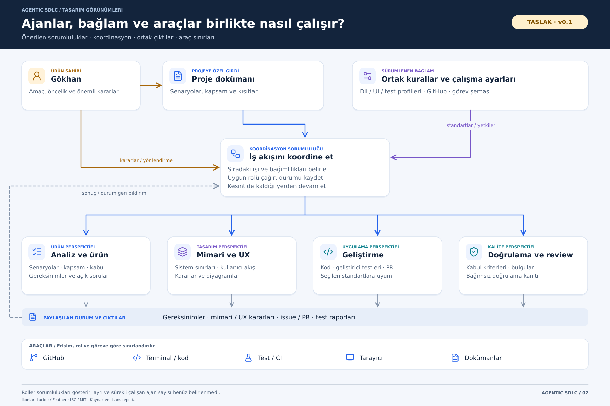

# Agentic SDLC

Gökhan'ın her yeni projede kullanacağı, proje fikrini gereksinimlere, mimariye, geliştirme görevlerine ve doğrulanmış teslimata dönüştüren ortak çalışma çatısı.

Bir projeye ait başlangıç dokümanı bu yapıya girdi olacak. Ortak mühendislik standartları, kişisel veya kurumsal çalışma ayarları ve proje gereksinimleri birlikte değerlendirilerek ilerleme yolu hazırlanacak.

Mevcut aşama **araştırma ve gereksinimlerin netleştirilmesi**. Framework, ajan sayısı, teknoloji profilleri ve otomasyon mimarisi henüz seçilmedi.

## Taslak diyagramlar

[Süreç, ajan çalışma düzeni ve örnek proje mimarisi](docs/diagrams/README.md) ikonlu SVG ve PNG olarak hazırlandı. Görünümler taslak v0.1 durumundadır; tasarım kararları araştırmayla netleştikçe güncellenecek.

## Başlangıç belgeleri

- [Hedef ve gereksinimler](docs/hedef-ve-gereksinimler.md)
- [Araştırma planı](research/plan.md)
- [Kaynak listesi](research/sources.md)
- [Yaklaşımları karşılaştırma ölçütleri](research/comparison-criteria.md)
- [İlk araştırma görevleri ve GitHub bağlantıları](research/backlog.json)

## Çalışma düzeni

Araştırma, kaynakların kendi açıklamaları ve çalışan örnekleri üzerinden ilerler. Yazarın önerisi, deney sonucu ve bizim çıkarımımız birbirinden ayrılır. Kaynak notları bir yöntemi benimseme kararı sayılmaz.

Bu çalışma için görev takibi [GitHub Issues](https://github.com/gaskinimbuspro/agentic-sdlc/issues) üzerinde tutulur. `research/backlog.json` ilk görev tanımlarını ve issue bağlantılarını içerir; güncel görev durumunun kaynağı GitHub Issues'dur. Gelecekte üretilecek projelerde başka bir takip sistemini destekleme ihtiyacı ayrıca değerlendirilecek.

İlk araştırma, aynı örnek proje dokümanını BMad Method, AWS AI-DLC ve GitHub Spec Kit ile karşılaştırır. Ardından backend, UI, test, repo hazırlama ve görev yönetimi standartları incelenir. Küçük deneylerden sonra uygun kararlar gerekçeleriyle kaydedilir.
