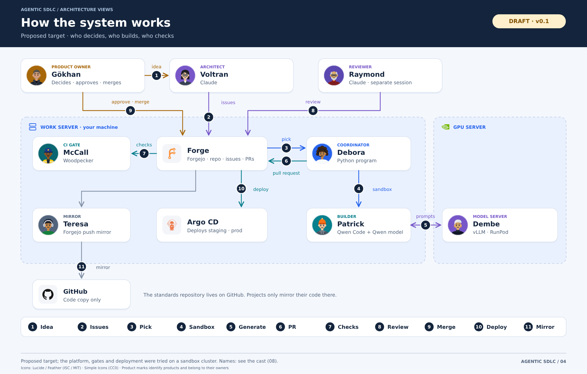

# Agentic SDLC

A reusable method for turning a project brief into requirements, architecture, bounded development tasks, and verified delivery.

The [backend standard v0.1](standards/backend/README.md) includes shared rules, Python/.NET/Go reference bindings, real PostgreSQL acceptance tests and verification tools, integrated through independently reviewed [PR #6](https://github.com/gaskinimbuspro/agentic-sdlc/pull/6). The [planning](standards/planning/README.md), [UI/UX](standards/ui/README.md), [operations](standards/operations/README.md), [agent delivery](standards/agent-delivery/README.md) and [production adoption](standards/adoption/README.md) standards are v0.1 specifications with reference checks. None has been exercised by an agent pilot on a real project yet; that pilot, an executing dispatcher and protected acceptance authority remain separate work.

## Where a new project starts

Continuing this repository's work in a fresh conversation? Read current GitHub state first. The [backend/UI context handoff](docs/handoffs/2026-11-16-ui-standard.md) is a historical record.

Give the Coordinator a project brief plus working settings. The Backend Architect/Planner clarifies behavior, records decisions, prepares the project profile/test plan, and splits work. The Coordinator dispatches ready tasks. One Implementer owns a coding task; independent review and trusted CI evidence control completion.

Start with the [planning standard](standards/planning/README.md), then [delivery workflow](standards/backend/delivery-workflow.md), [test case matrix](standards/backend/test-case-matrix.md), and [Definition of Done](standards/backend/definition-of-done.md).

## Repository map

- [Goals and requirements](docs/goals-and-requirements.md)
- [Target architecture: who does what, where it runs, how a project starts](docs/architecture/README.md)
- [Planning: discovery questionnaire, requirements and architecture records](standards/planning/README.md)
- [Backend standard and language profiles](standards/backend/README.md)
- [UI/UX standard and design readiness](standards/ui/README.md)
- [Database, platform/GitOps and security standards](standards/operations/README.md)
- [Production adoption profiles and evidence](standards/adoption/README.md)
- [Agent delivery, agent security, integration and measurement](standards/agent-delivery/README.md)
- [Customer-admin frontend reference and browser checks](reference/frontend/README.md)
- [Research plan](research/plan.md)
- [Research sources](research/sources.md)
- [Method comparison criteria](research/comparison-criteria.md)
- [Research tasks and GitHub links](research/backlog.json)
- [Agent infrastructure notes: practices and Kubernetes projects](research/2026-11-21-agent-infrastructure-notes.md)
- [Draft process and architecture diagrams](docs/diagrams/README.md)

## Working method

Keep source claims, experiments, and our proposed policies distinct. A vendor article or attractive diagram is not proof of production reliability. Compare methods using the same brief and independent acceptance criteria before selecting the orchestration implementation.

[GitHub Issues](https://github.com/gaskinimbuspro/agentic-sdlc/issues) is the current task-status source. `research/backlog.json` records task definitions and links, not a competing status database. Future projects may use a different tracker through a deliberate integration policy.

All repository content is maintained in English. Framework, model routing, deployment topology, and final runtime/tool versions remain project decisions.
