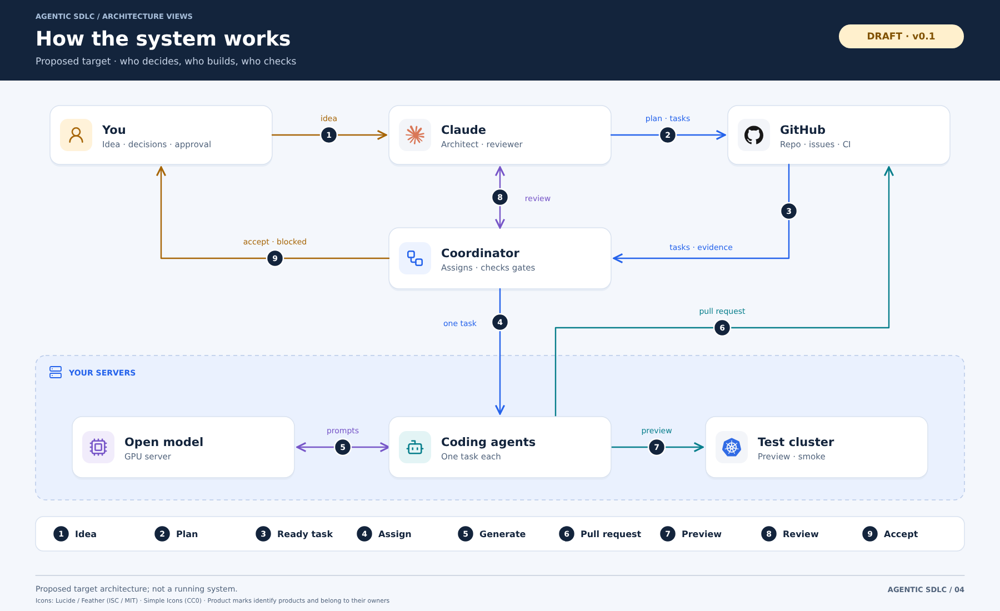
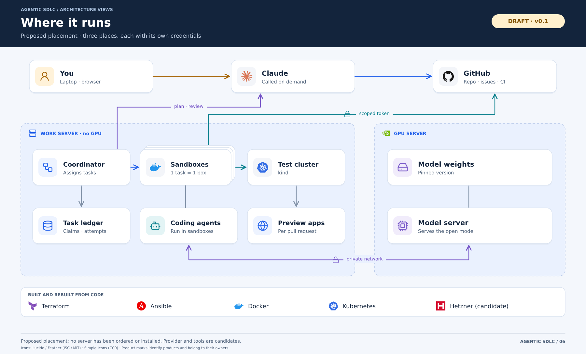
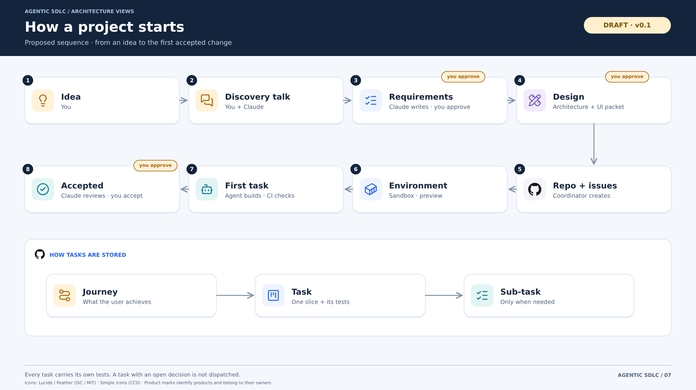

# Target architecture

Status: **proposed, not installed**. This document describes how the method is intended to run on real projects. No server has been ordered, no dispatcher is running and no agent has executed a task under it. Runtime, model, provider and price statements are candidates to verify in a pilot; see [open decisions](#open-decisions-and-unverified-assumptions).

## Who does what

| Actor | Does | Does not |
| --- | --- | --- |
| You (product owner) | State the idea, answer product and risk questions, approve scope, requirements, design and release | Remind agents to test, review routine code |
| Claude (architect and reviewer) | Run discovery, write requirements and architecture, prepare the UI packet, split work into tasks, review candidates, help when a task is blocked | Write the implementation it reviews, run continuously, hold merge or deploy credentials |
| Coordinator (a program, not a model) | Check readiness, claim one task per worker, enforce budgets and gates, read CI evidence, open and update GitHub records | Decide product behavior, judge design quality |
| Coding agents (open model on your GPU) | Implement one bounded task with its tests in an isolated sandbox, open a pull request, write a handoff | Change requirements, acceptance policy, workflows or their own permissions |
| CI | Run the required checks on the exact candidate and publish reports | Give opinions |

The split follows the existing [role contract](../../standards/backend/agent-contract.md). Using a different model to review than to implement reduces shared mistakes; it does not replace the gates.

## Lifecycle

| Stage | Owner | Output | Gate before the next stage |
| --- | --- | --- | --- |
| Discover | You with Claude | Brief with scope and non-goals | You agree the scope |
| Specify | Claude, you approve | Requirements with concrete examples | [RQ01–RQ06](../../standards/planning/requirements.md) |
| Design | Claude, you approve | Architecture records and, for a UI, the design packet | [AR01–AR05](../../standards/planning/architecture.md), [UI design validation](../../standards/ui/README.md#executable-scope) |
| Plan | Claude | Tasks as GitHub issues, with dependencies and case IDs | [G0 Ready](../../standards/backend/testing.md#gates) |
| Build | One coding agent per task, assigned by the Coordinator | Code, tests, pull request, handoff | G1 Local |
| Verify | CI, then Claude as independent reviewer | Candidate-bound reports and a review verdict | G2 Clean CI and G3 Independent acceptance |
| Release | You authorize, Coordinator executes | Running version with smoke evidence | G4 and G5, when deployment is in scope |

A failed check returns the task to Build within its repair budget. A missing decision, exhausted budget or missing access blocks the task and reaches you. Recurring corrections become standard changes under [ME06](../../standards/agent-delivery/measurement.md).

## Why Claude is not the always-on manager

Supervising agents around the clock with a hosted model would consume the same budget the design is meant to save. The Coordinator handles the continuous, mechanical part: queues, claims, timeouts, gate checks. Claude is called at four points only: discovery and planning, task breakdown, candidate review, and a blocked task that needs judgment. Everything it needs at those points is read from versioned files and the task record, not from a long conversation.

## Where it runs

| Place | Runs | Holds | Must not hold |
| --- | --- | --- | --- |
| GPU server | Model server and pinned model weights | A private-network endpoint with authentication ([AS08](../../standards/agent-delivery/security.md)) | Source code, GitHub credentials |
| Work server, no GPU | Coordinator and its ledger, one sandbox per task, a disposable `kind` test cluster, preview applications | Short-lived, branch-scoped tokens per worker ([AS04](../../standards/agent-delivery/security.md)) | Merge, release or production credentials inside a sandbox |
| GitHub | Repositories, issues, pull requests, CI, evidence artifacts | Required checks and protected policy | — |
| Claude | Called through its API or app when needed | Only the files sent for the current decision | Standing access to the servers |

Each task runs in its own sandbox with an outbound allowlist ([AS03](../../standards/agent-delivery/security.md)). The `kind` cluster is for tests and previews; it is not a production target. Production deployment uses the project's own [GitOps profile](../../standards/adoption/gitops.md).

## How a project starts

1. You describe the idea.
2. Claude runs the [discovery sequence](../../standards/planning/README.md#discovery-sequence) until every in-scope behavior has an example or an open decision.
3. You approve the requirements.
4. You approve the architecture and, for a UI, the design packet: every screen, state, action destination and API outcome.
5. The Coordinator creates the repository and issues through the [GitHub operation contract](../../standards/agent-delivery/README.md#github-operation-contract).
6. The environment for the project is prepared: sandbox image, test cluster namespace, preview route.
7. The first ready task is assigned to one agent and checked by CI.
8. Claude reviews the candidate and you accept the first integrated change.

### Task structure

| Level | Meaning | Stored as |
| --- | --- | --- |
| Journey | What a user achieves | Parent issue |
| Task | One vertical slice with its own tests, independently verifiable | Issue |
| Sub-task | Used only when a task has separable steps | Sub-issue |

There is no separate "write tests later" task. A task that depends on an open decision stays in draft.

## Scale

Start with one coding agent and one reviewer, working serially, until gates and evidence behave as specified. Move to two or three parallel agents only for tasks with compatible contracts and non-overlapping changes, and compare the result under [ME04](../../standards/agent-delivery/measurement.md). The published reports reviewed in [research](../../research/2026-11-15-standards-and-agentic-delivery.md) describe coordination problems from unplanned parallelism; they do not prescribe a number for this setup.

## Build order

| Phase | Deliverable | Exit condition |
| --- | --- | --- |
| 0. Decide | Provider, model, runtime and budget chosen from the open decisions below | Recorded decisions with verified prices |
| 1. Model | Model server on a rented GPU, authenticated, on a private network | A scripted prompt returns; an unauthenticated request is refused |
| 2. Work server | Sandbox runtime, test cluster, agent runtime connected to the model | One agent completes a trivial task in a sandbox with no host access |
| 3. Coordinator | Ledger, claims, budgets and GitHub operations bound to one repository | Duplicate claim, expiry and lost-response cases behave as [AD02, AD05 and AD07](../../standards/agent-delivery/README.md) require |
| 4. Pilot | One small real project from idea to accepted change | Measured under [ME01–ME04](../../standards/agent-delivery/measurement.md); false completions and human interventions recorded |
| 5. Scale | Parallel agents and a fixed-price server if the numbers justify it | Reviewed capacity, cost and defect comparison |

Provision cloud resources with Terraform and configure servers with a configuration tool so that the environment can be rebuilt. Whether a rented physical GPU server can be ordered through the provider's API has not been verified. No infrastructure code exists in this repository yet; it is written in phase 1 against the chosen provider.

## Open decisions and unverified assumptions

| Topic | Candidate | Status |
| --- | --- | --- |
| Agent runtime | OpenHands in headless mode | Identified from its documentation through search summaries; not installed or run. Recovery, sandbox isolation and local-model reliability are unverified. |
| Model serving | vLLM for concurrent agents; Ollama for single-user use | Not installed. Tool-calling behavior with the chosen model is unverified. |
| Model | An open-weight coding model from the Qwen family | Not selected. Published benchmark figures vary by source and harness. |
| GPU for the pilot | Hourly rental of a card with about 48 GB memory | Prices move; verify on the provider's page. |
| GPU after the pilot | A fixed-price dedicated server, Hetzner as one candidate | Search results disagreed on current prices. No order placed. |
| Benefit of the split | Hosted architect and reviewer, local implementer | The strongest independent study found gains from planner-executor designs uneven. Measure in the pilot. |
| Coordinator | Extend [`DispatchLedger`](../../src/backend_standard/dispatch.py) or adopt an existing engine | The library covers claims, expiry and operation intents only. |
| Identity for review | A reviewer identity separate from the implementing identity | Not configured; required by [D08](../../standards/backend/definition-of-done.md). |
