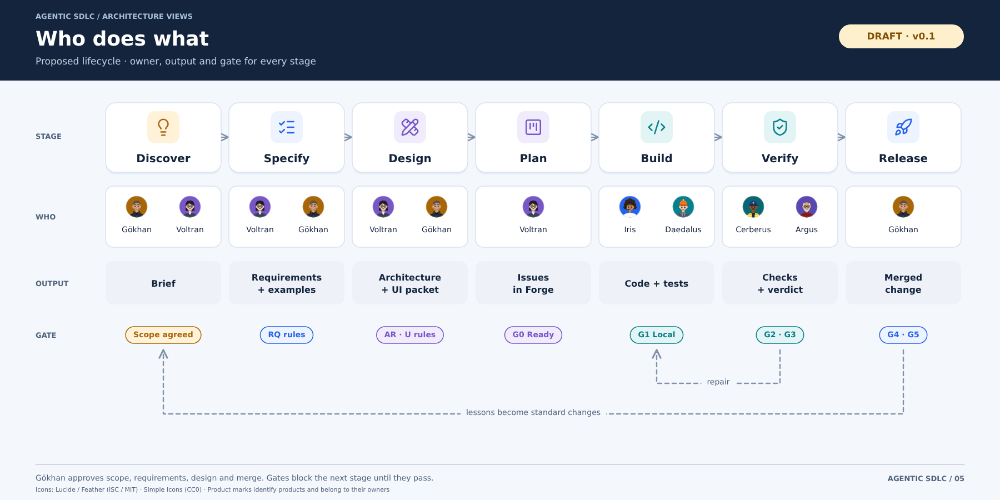
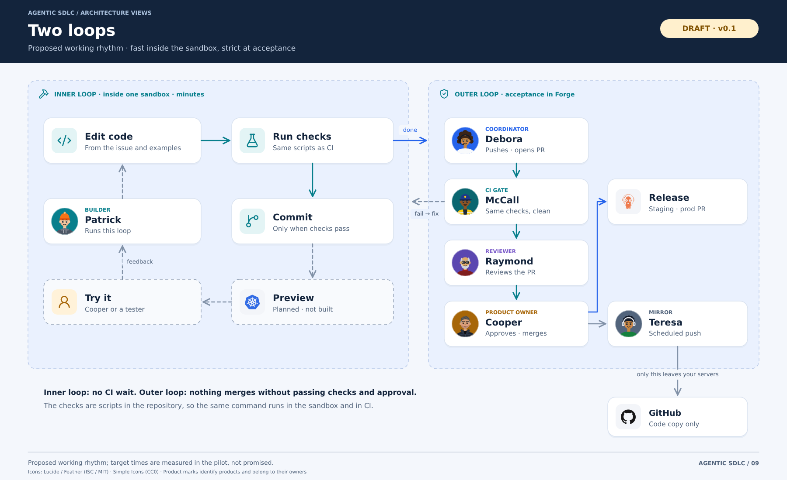

# Target architecture

Status: **proposed; parts tried in a sandbox**. This document describes how the method is intended to run on real projects. No server has been ordered and no model-driven agent has executed a task under it. The platform, Debora with a stand-in builder, the pull-request gate and the release path to staging and prod were exercised in a temporary sandbox cluster; see the [platform trial](../../platform/README.md#what-was-tested-and-where). Tool, model, provider and price statements are candidates to verify in the [pilot](pilot-runbook.md); see [open decisions](#open-decisions-and-unverified-assumptions).

The actors have names; see [the cast](cast.md).

## Who does what

| Character | Role | Does | Does not |
| --- | --- | --- | --- |
| Cooper | Product Owner | States the idea, answers product and risk questions, approves scope, requirements, design and merge | Remind agents to test, review routine code |
| Voltran (Claude) | Architect | Runs discovery, writes requirements and architecture, prepares the UI packet, splits work into tasks, helps when a task is blocked | Write the implementation, run continuously |
| Raymond (Claude, separate session) | Reviewer | Reviews each pull request against the requirements and examples | Review its own work, merge |
| Debora (a program, not a model) | Coordinator | Picks ready issues, opens sandboxes, starts Patrick with limits, pushes branches, opens pull requests | Decide product behavior, judge design quality |
| Patrick (Qwen Code + Qwen model) | Builder | Implements one task with its tests in an isolated sandbox | Pick tasks, push, change requirements, workflows or its own permissions |
| McCall (Woodpecker) | CI gate and release | Runs the required checks on each pull request; after a merge builds the image once and sets its digest for staging | Give opinions, deploy to the cluster |

The split follows the existing [role contract](../../standards/backend/agent-contract.md). Reviewing with a different model from the one that implements reduces shared mistakes; it does not replace the gates.

## Lifecycle

| Stage | Owner | Output | Gate before the next stage |
| --- | --- | --- | --- |
| Discover | Cooper with Voltran | Brief with scope and non-goals | Cooper agrees the scope |
| Specify | Voltran, Cooper approves | Requirements with concrete examples | [RQ01–RQ06](../../standards/planning/requirements.md) |
| Design | Voltran, Cooper approves | Architecture records and, for a UI, the design packet | [AR01–AR05](../../standards/planning/architecture.md), [UI design validation](../../standards/ui/README.md#executable-scope) |
| Plan | Voltran | Issues in Forge, with dependencies and case IDs | [G0 Ready](../../standards/backend/testing.md#gates) |
| Build | Patrick, started by Debora | Code, tests, local commits; Debora opens the pull request | G1 Local |
| Verify | McCall, then Raymond | Check reports and a review verdict | G2 Clean CI and G3 Independent acceptance |
| Release | Cooper authorizes | Merged change, and a running version when deployment is in scope | G4 and G5, when in scope |

A failed check returns the task to Build within its repair budget. A missing decision, exhausted budget or missing access blocks the task and reaches Cooper. Recurring corrections become standard changes under [ME06](../../standards/agent-delivery/measurement.md).

## Why Claude is not the always-on manager

Supervising agents around the clock with a hosted model would consume the budget the design is meant to save. Debora handles the continuous, mechanical part: queue, claims, time limits, pushing and opening pull requests. Claude is called at four points only: discovery and planning as Voltran, task breakdown as Voltran, review as Raymond, and a blocked task that needs judgment. Everything it needs is read from versioned files and the issue, not from a long conversation.

Debora is deliberately not a model. A model given the git token and the task queue would set its own limits and could be steered by text inside an issue ([AS01 and AS02](../../standards/agent-delivery/security.md)).

## Where it runs

| Place | Runs | Must not hold |
| --- | --- | --- |
| GPU server (RunPod for the pilot) | Dembe: vLLM serving the pinned model behind an API key ([AS08](../../standards/agent-delivery/security.md)) | Source code, git credentials |
| Work server, no GPU | A k3s cluster installed by [platform bootstrap](../../platform/README.md): Argo CD, Forge (Forgejo), McCall (Woodpecker, steps as pods), Debora on Argo Workflows with one pod per step, staging and prod namespaces deployed by Argo CD |  Production credentials; git tokens inside a sandbox |
| GitHub | The agentic-sdlc standards repository, and Teresa's mirror copies of project code | Project CI, pull requests or issues |
| Claude | Voltran and Raymond, called when needed | Standing access to the servers |

Each sandbox has an outbound allowlist ([AS03](../../standards/agent-delivery/security.md)). The work-server cluster is for staging and the trial; real production uses its own cluster under the [GitOps profile](../../standards/adoption/gitops.md), with the same deploy-repository flow.

## Source of truth and mirroring

| Repository | Primary | Copy | What the copy carries |
| --- | --- | --- | --- |
| agentic-sdlc (standards) | GitHub | Read-only pull mirror in Forge, so agents read standards locally | Code only |
| Each project | Forge | Teresa pushes to GitHub on a schedule | Code and branches only |

Rules:

- Nobody develops on a copy. If two places accept changes, they diverge.
- GitHub Actions stay disabled on mirror repositories; GitHub runs no project CI.
- Teresa does not copy issues, pull requests or CI history. Back up Forge's own data separately; the mirror does not replace that backup.
- Each project pins a released tag of agentic-sdlc. A change to the standards reaches a project only through a deliberate upgrade ([R13](../goals-and-requirements.md#requirements)).

## Two loops

**Inner loop, minutes, inside the sandbox.** Patrick edits code, runs the same check scripts the project uses in CI, and, once previews are built, deploys the change to a short-lived preview namespace that Cooper or a tester can open at once. Nothing in this loop waits for CI.

**Outer loop, acceptance.** Debora pushes the branch and opens a pull request in Forge. McCall runs the same scripts in a clean container. Raymond reviews. Forge's branch protection blocks the merge until the checks pass and Cooper approves.

The check logic lives in scripts in the repository, as with this repository's `backend-verify`. The Woodpecker pipeline only calls them. The same command therefore runs in the sandbox, in CI and on a laptop, and replacing the CI tool or the git server does not change the checks.

## Deployment

Agents propose changes; pipelines build; only Argo CD changes the cluster. Nobody else, and no agent, holds cluster credentials.

| Step | Who | What happens |
| --- | --- | --- |
| 1 | Debora | Opens a pull request in the source repository |
| 2 | McCall | Runs the required check; Forgejo shows the status on the pull request |
| 3 | Raymond, then Cooper | Review; Cooper approves and merges. Agents cannot merge and nobody pushes to main |
| 4 | McCall | On main, after the check passes again: builds the image once, records its digest, writes the digest into `overlays/staging` of the deploy repository |
| 5 | Argo CD | Syncs staging from the deploy repository |
| 6 | Release bot, then Cooper | A pull request in the deploy repository copies the staging digest to `overlays/prod`; Cooper approves and merges after checking staging |
| 7 | Argo CD | Syncs prod; the running digest is the one built in step 4 |

The release token is a Woodpecker secret limited to push events, so pipelines started by a pull request cannot read it. The deploy repository lets the release bot push only the staging overlay; every other change needs Cooper's approval and merge. Templates and scripts are in [platform/templates](../../platform/templates/README.md).

Not built yet: pull-request preview environments, schema migrations as a pre-sync job, a secrets manager for application secrets, and an automated staging smoke test before the prod pull request.

## How a project starts

The view marks each step as tried in the sandbox, built but not yet used, or not built.

1. Cooper describes the idea.
2. Voltran runs the [discovery sequence](../../standards/planning/README.md#discovery-sequence) until every in-scope behavior has an example or an open decision.
3. Cooper approves the requirements.
4. Cooper approves the architecture and, for a UI, the design packet: every screen, state, action destination and API outcome.
5. Voltran writes the [task plan](../../standards/planning/tasks.md) `plan/tasks.json` in a pull request; McCall validates it and Cooper merges it. McCall then creates one issue per task with its dependencies: tasks with no open dependency are `ready`, the rest `waiting`, and tasks with an open decision `draft`. Teresa's mirror to GitHub is configured once per project.
6. The project environment is prepared on the platform: Debora's configuration and secrets, builder image, the Woodpecker pipelines and branch protection, the deploy repository and its Argo CD applications ([deployment](#deployment)).
7. Debora gives the oldest ready issue to Patrick; McCall checks the pull request. Before each claim, Debora marks `waiting` tasks `ready` once the issues they depend on are closed by merged pull requests.
8. Raymond reviews and Cooper merges the first change.

### Task structure

| Level | Meaning | Stored as |
| --- | --- | --- |
| Journey | What a user achieves | Parent issue in Forge |
| Task | One vertical slice with its own tests, independently verifiable | Issue |
| Sub-task | Only when a task has separable steps | Issue linked to its parent; Forgejo's dependency feature to be verified |

There is no separate "write tests later" task. A task that depends on an open decision stays in draft.

## Planned additions

Agreed with the product owner, not built yet. Feedback to the builder, notifications and the board come from [Orchestrator.inc](https://github.com/OrchestratorInc/agent-orchestrator); see the [research note](../../research/2026-11-21-agent-infrastructure-notes.md#orchestratorinc-assessed-22-november). The approval policy comes from Claude Ship's Claude Approvals; see the [survey](../../research/2026-11-22-agentic-tooling-survey.md#claude-ship-assessed-26-november).

| Addition | What it does | Built on |
| --- | --- | --- |
| Raymond review | Claude reviews each pull request against the task's acceptance criteria and reports a required commit status and a review comment. Cooper still approves and merges. | The Claude API, with the key from the secrets store |
| Feedback to the builder | When a required check fails or a review asks for changes, Debora runs Patrick again on the same branch with the check output or the review findings, within the task's repair budget, and pushes the fix. After the budget, the task is `blocked`. Claude Ship's PR Steward does the same on GitHub with Claude; ours uses Patrick's local model to keep the cost per fix low. | Debora's repair rounds, Forgejo commit statuses and reviews |
| Path-based approval policy | A policy file in each project, for example `.forgejo/approvals.json`, names which paths need which approvers: for example, `migrations/*`, `platform/*` and `.woodpecker/*` need Cooper and a passing Raymond review, while documentation needs Cooper only. A Woodpecker check reports what the policy decides. It starts in observe mode and becomes a required check only when Cooper decides. Built after the Raymond review, which its rules refer to. | Forgejo's API and branch protection |
| "Needs you" notifications | A push message to Cooper's phone when a task is `blocked`, a pull request waits for approval, or a deployment to prod waits for a merge. | A self-hosted notification service; the message carries a link, not code or secrets |
| Board | One view with a column per state: draft, waiting, ready, in progress, review, blocked, done. | Forgejo's project board, driven by the existing labels |

### Claude Ship on this repository

This standards repository is on GitHub, so the product owner can use Claude Code's `/ship` command on it: in a local clone, with the GitHub CLI signed in, commit the change on a branch other than `main` (the repository is public, so `/ship` does not commit uncommitted work here), then run `/ship`. It opens the pull request, reviews it and keeps fixing review findings and failing checks from that session; the product owner still merges. The run counts against the product owner's own Claude usage. Claude Ship's organization agents need a Team or Enterprise plan and are not in use. Neither is used for project repositories on Forgejo.

## Scale

Start with one Patrick and one Raymond, working serially, until gates and evidence behave as specified. Move to two or three parallel builders only for tasks with compatible contracts and non-overlapping changes, and compare the result under [ME04](../../standards/agent-delivery/measurement.md). At that point Debora needs exclusive claims, expiry and recovery, either from the repository's [`DispatchLedger`](../../src/backend_standard/dispatch.py) or an existing orchestrator.

## Build order

| Phase | Deliverable | Exit condition |
| --- | --- | --- |
| 0. Decide | Model, provider account and budget | Recorded decisions with verified prices |
| 1. Dembe | vLLM on a rented GPU, authenticated | A scripted prompt and a tool call return; an unauthenticated request is refused |
| 2. Work server | Forge, McCall, Teresa, sandbox runtime, registry, k3s; Patrick connected to Dembe | Patrick completes a trivial task in a sandbox with no host access; a failing check blocks a merge |
| 3. Debora | The serial coordinator script for one repository | One issue becomes a reviewed pull request with nobody editing the branch |
| 4. Pilot | One small real project from idea to accepted change | Measured under [ME01–ME04](../../standards/agent-delivery/measurement.md) |
| 5. Scale | Parallel builders and a fixed-price GPU if the numbers justify it | Reviewed capacity, cost and defect comparison |

Phases 1 to 4 are described in the [pilot runbook](pilot-runbook.md). The work-server platform is installed from [platform/](../../platform/README.md) with Terraform and Argo CD, so it can be rebuilt; the GPU server is not automated yet.

## Open decisions and unverified assumptions

| Topic | Choice | Status |
| --- | --- | --- |
| Git server (Forge) | Forgejo | Chosen by the product owner. Installed and exercised in the [platform trial](../../platform/README.md#what-was-tested-and-where). Push mirror and branch protection not yet configured. |
| CI (McCall) | Woodpecker with the Kubernetes backend, installed by Argo CD | Chosen by the product owner after comparing it with Tekton: native Forgejo support, commit status and pull-request events without extra glue. Tried in the sandbox: pull-request check, status on the pull request, merge blocked on failure, release to staging. |
| Deployment | Argo CD with one deploy repository per project; staging automatic, prod by approved pull request | Tried in the sandbox ([deployment](#deployment)). Pull-request previews, database migrations and a secrets manager are not built yet. |
| Builder tool (Patrick) | Qwen Code in headless mode; OpenCode run on the same tasks for comparison | Chosen for trial. Documentation describes `qwen -p` and OpenAI-compatible endpoints; tool calls through vLLM are unverified. OpenHands is the fallback. |
| Model (Dembe) | An open-weight model from the Qwen family | Search results indicated that Qwen 3.7 has no open weights; confirm on the publisher's model card. |
| GPU for the pilot | RunPod, about 48 GB | Chosen. Rates differed between sources; verify on the provider's page. |
| GPU after the pilot | A fixed-price dedicated server | Decide from pilot utilization. |
| Coordinator (Debora) | [Debora](iris.md) as an Argo Workflows template, one pod per step; `iris run-once` for a single host | Ran on Argo Workflows against a real Forgejo with a stand-in builder in the [platform trial](../../platform/README.md#what-was-tested-and-where). Not yet with Qwen Code or a real model. |
| Secrets store | Bitwarden Secrets Manager; Bitwarden's Kubernetes operator (sm-operator) syncs secrets into the cluster, one read-only machine account per consumer | Chosen by the product owner. Not installed. The operator needs one bootstrap token per namespace, entered by Cooper on the server; agents never receive Bitwarden access. |
| Mirror (Teresa) | Forgejo push mirror to GitHub | Interval to be chosen. Forge's own backup is a separate, open task. |
| Benefit of the split | Hosted Voltran and Raymond, local Patrick | The strongest independent study found gains from planner-executor designs uneven. Measure in the pilot. |
