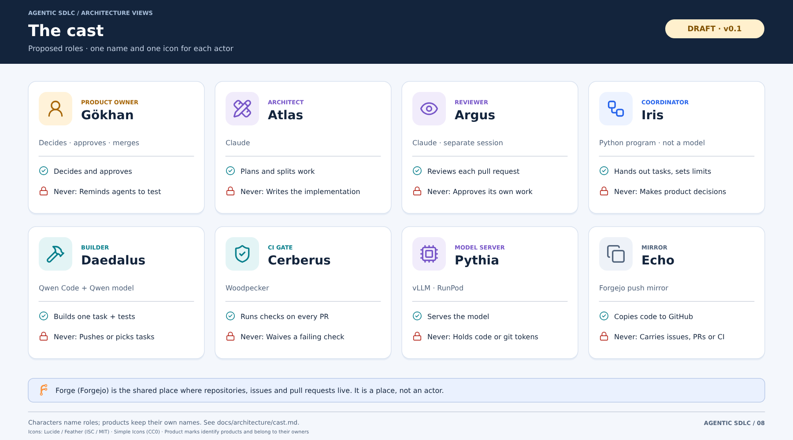

# The cast

Every role in the [target architecture](README.md) has a name and an icon, so that documents, diagrams and conversations refer to the same actor. The names are labels for roles. The products underneath keep their own names, and the standards keep their role names and rule IDs.

| Character | Role | Runs as | Does | Never does |
| --- | --- | --- | --- | --- |
| **Gökhan** | Product Owner | A person | States the idea, decides product and risk questions, approves scope, requirements, design and merge | Reminds agents to run their checks |
| **Atlas** | Architect | Claude, called on demand | Runs discovery, writes requirements and architecture, prepares the UI packet, splits work into tasks | Writes the implementation |
| **Argus** | Reviewer | Claude, in a separate session from Atlas | Reviews each pull request against the requirements and examples | Approves its own work, merges |
| **Iris** | Coordinator | A small Python program on the work server | Picks a ready issue, opens a sandbox, starts Daedalus with time and attempt limits, pushes the branch, opens the pull request | Makes product or design decisions; it is not a model |
| **Daedalus** | Builder | Qwen Code driving a Qwen model, one sandbox per task | Implements one task with its tests, runs them, repairs failures, commits locally | Chooses tasks, pushes, holds git server credentials, changes its own rules |
| **Cerberus** | CI gate | Woodpecker on the work server | Runs the required checks on every pull request in a clean container | Gives opinions or waives a failure |
| **Pythia** | Model server | vLLM on a rented GPU | Serves the pinned Qwen model to Daedalus behind an API key | Holds source code or git credentials |
| **Echo** | Mirror | Forgejo's push mirror | Copies project code to GitHub on a schedule as a backup | Carries issues, pull requests or CI; nobody develops on the copy |

**Forge** is Forgejo, the place where repositories, issues and pull requests live. It is a place, not an actor, so it has no character.

## Credentials

| Character | Holds | Does not hold |
| --- | --- | --- |
| Iris | A Forgejo token for the project repositories: read issues, push task branches, open pull requests | Merge rights, GitHub credentials, production access |
| Daedalus | The model API key, inside its sandbox only | Any git server token |
| Cerberus | Read access to the repository it tests | Write access to protected branches, production access |
| Echo | A GitHub token limited to the mirror repositories | Anything else |
| Gökhan | Merge rights on protected branches | — |

Keeping push and pull-request rights with Iris instead of Daedalus means injected text in an issue cannot make the model write to the git server directly ([AS01, AS02 and AS04](../../standards/agent-delivery/security.md)).

## Mapping to the standards

| Standard role | Character |
| --- | --- |
| Human / product owner | Gökhan |
| Backend Architect / Planner, UX Planner | Atlas |
| Independent Reviewer | Argus |
| Coordinator | Iris |
| Implementer | Daedalus |
| CI | Cerberus |

The names were chosen to avoid tools that already appear in this stack: Hermes is also a model family, Talos a Kubernetes operating system and Prometheus a monitoring system. Rename a character here and in the diagram generator together.
