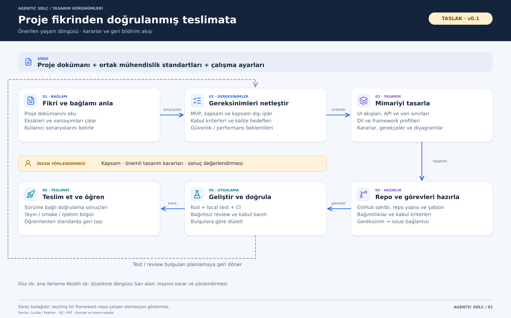

# Mimari ve süreç diyagramları

Bu görünümler, araştırma sırasında tartışılacak çalışma düzenini somutlaştırır. Üçü de **taslak v0.1** durumundadır; seçilmiş framework, kesin ajan sayısı veya çalışan otomasyon beyanı değildir.

## Geliştirme süreci

Proje dokümanından gereksinim, mimari, repo ve görev hazırlığı, geliştirme, doğrulama ve teslimata geçişi gösterir. Kesikli ok, test ve inceleme bulgularının planlamaya geri dönmesini anlatır. İnsan yönlendirmesi tüm süreç boyunca geçerlidir.



[SVG](01-development-process.svg) · [PNG](01-development-process.png)

## Ajanların çalışma düzeni

Ürün sahibi, projeye özel girdi, ortak standartlar, koordinasyon sorumluluğu, uzmanlık rolleri, paylaşılan çıktılar ve araçlar arasındaki ilişkileri gösterir. Dört uzmanlık kutusu sorumluluk alanlarıdır; ayrı ve kalıcı dört ajan kurulması kararı değildir. Araç erişimi rol ve görev için sınırlandırılır. Koordinasyonun hangi araçla uygulanacağı araştırmada belirlenecek.


[SVG](02-agent-structure.svg) · [PNG](02-agent-structure.png)

## Bir proje için teknik mimari örneği

Web arayüzü, API, iş kuralları, veri ve entegrasyon sorumluluklarını örnekler. Oklar çalışma zamanındaki etkileşimleri anlatır. Mantıksal sorumlulukların ayrı kutularda olması, ayrı mikroservisler veya repository'ler gerektirmez. Teknoloji, kimlik mekanizması ve deployment profili projeye göre seçilecek.


[SVG](03-project-architecture.svg) · [PNG](03-project-architecture.png)

## Düzenleme ve yeniden üretme

SVG dosyaları vektöreldir; SVG destekleyen editörlerde düzenlenebilir. Tekrarlanabilir üretim kaynağı [render_diagrams.py](../../scripts/render_diagrams.py) dosyasıdır. Üretilen SVG veya PNG üzerinde doğrudan yapılan değişiklikleri korumak için generator kaynağına da aktarın.

Python 3.10 veya üzeri, Pillow, Inkscape ve DejaVu Sans fontları gerekir. Repo kökünde şu komut üç SVG ve üç PNG dosyasını yeniden üretir:

```sh
python scripts/render_diagrams.py
```

Üretim yerel ikonlarla çalışır; ağ erişimi gerektirmez. Başlık ve metin genişlikleri üretim sırasında kontrol edilir. PNG'ler 1800 piksel genişliğindedir; sunum ve yakınlaştırma için SVG tercih edilebilir.

İkonların sürümü, kaynağı ve lisansları [Lucide kaynak notunda](assets/lucide/README.md) kayıtlıdır. Lisans metinleri SVG metadata'sında ve PNG metadata'sında da bulunur.
