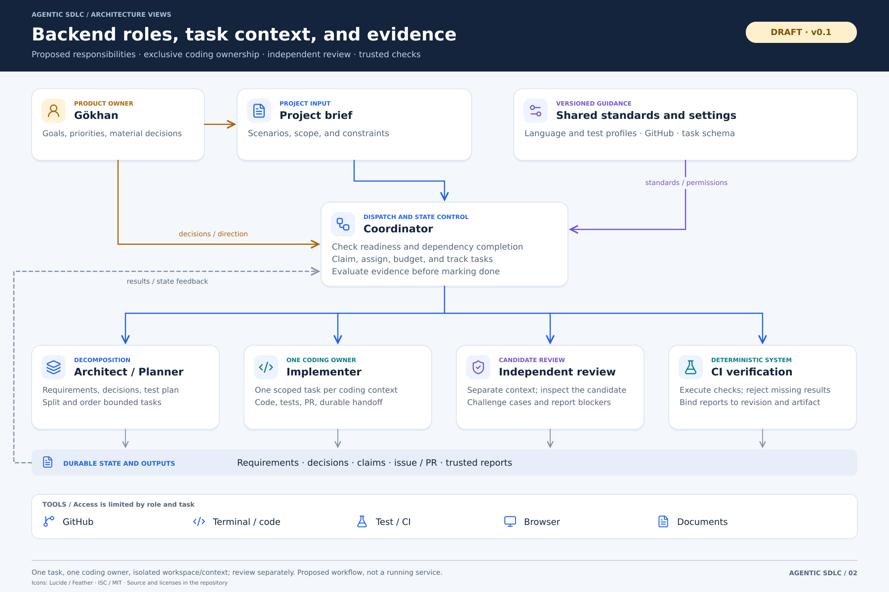
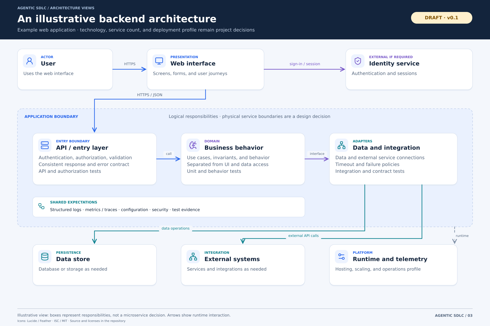

# Process and architecture diagrams

These views make the proposed method discussable. All are **draft v0.1**. They do not claim an implemented dispatcher, a fixed model/agent count, or a finalized application topology.

## Development process

The view covers brief, requirements, architecture, repository/tasks, implementation/verification, and delivery. Dashed arrows represent findings returning to planning. Human direction applies throughout.


[SVG](01-development-process.svg) · [PNG](01-development-process.png)

## Backend agent responsibilities

The human supplies intent. The Architect/Planner decomposes work; the Coordinator dispatches ready packets; one Implementer owns a coding task; the Independent Reviewer checks the candidate; CI supplies execution evidence. Shared artifacts carry state across scoped sessions. Role boxes are not permanent process/model counts. See the normative [delivery workflow](../../standards/backend/delivery-workflow.md).



[SVG](02-agent-structure.svg) · [PNG](02-agent-structure.png)

## Illustrative project architecture

The view separates UI, API, business behavior, and data/integration responsibilities. Arrows show runtime interactions. Separate logical boxes do not require separate microservices/repositories. Actual technology, identity, and deployment profiles are project decisions.



[SVG](03-project-architecture.svg) · [PNG](03-project-architecture.png)

## Edit and regenerate

SVG files are editable vectors. The repeatable source is [render_diagrams.py](../../scripts/render_diagrams.py). Carry direct SVG/PNG edits back into the generator if they must survive regeneration.

Requires Python 3.10+, Pillow, Inkscape, and DejaVu Sans fonts. From the repository root:

```sh
python scripts/render_diagrams.py
```

Rendering uses local assets and no network. The generator checks card text widths. PNGs are 1800 pixels wide; use SVG for scaling. [Icon provenance and licenses](assets/lucide/README.md) are recorded, including notices in SVG/PNG metadata.
