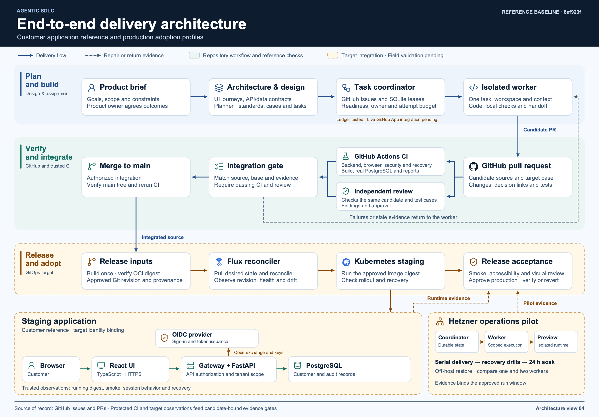

# Process and architecture diagrams

View 04 traces the end-to-end architecture against the current reference baseline. Views 01–03 preserve the earlier design sketches.

## End-to-end delivery architecture

Follow the solid arrows from the product brief through scoped implementation, parallel CI and independent review, and authorized source integration. The amber boundary marks the production adoption profiles and their required target evidence. Trace the staged customer request through React, the gateway and FastAPI, and PostgreSQL. The Hetzner pilot returns measured operating evidence to the release decision.



[Editable SVG](04-end-to-end-delivery-architecture.svg) · [PNG](04-end-to-end-delivery-architecture.png) · [Production adoption profiles](../../standards/adoption/README.md)

## Development process

The view covers brief, requirements, architecture, repository/tasks, implementation/verification, and delivery. Dashed arrows represent findings returning to planning. Human direction applies throughout.


[SVG](01-development-process.svg) · [PNG](01-development-process.png)

## Backend agent responsibilities

The human supplies intent. The Architect/Planner decomposes work; the Coordinator dispatches ready packets; one Implementer owns a coding task; the Independent Reviewer checks the candidate; CI supplies execution evidence. Shared artifacts carry state across scoped sessions. Role boxes are not permanent process/model counts. See the normative [delivery workflow](../../standards/backend/delivery-workflow.md).


[SVG](02-agent-structure.svg) · [PNG](02-agent-structure.png)

## Illustrative project architecture

The view separates UI, API, business behavior, and data/integration responsibilities. Arrows show runtime interactions. Separate logical boxes do not require separate microservices/repositories. Actual technology, identity, and deployment profiles are project decisions.


[SVG](03-project-architecture.svg) · [PNG](03-project-architecture.png)

## Edit and regenerate

SVG files are editable vectors. Edit [render_delivery_architecture.py](../../scripts/render_delivery_architecture.py) for view 04. It uses Python 3.10+, CairoSVG, Cairo, Pillow and Fontconfig with Arial or a metric-compatible font. On macOS with Homebrew Cairo, set `DYLD_FALLBACK_LIBRARY_PATH=/opt/homebrew/lib` if the loader cannot find Cairo.

```sh
python scripts/render_delivery_architecture.py
```

The view 04 PNG is 2400 pixels wide. The generator uses local assets and embeds the [vendor logo notices](assets/vendors/README.md) and [Lucide license](assets/lucide/README.md) in the exports.

The design sketches use [render_diagrams.py](../../scripts/render_diagrams.py).

Requires Python 3.10+, Pillow, Inkscape, and DejaVu Sans fonts. From the repository root:

```sh
python scripts/render_diagrams.py
```

Rendering uses local assets and no network. The generator checks card text widths. PNGs are 1800 pixels wide; use SVG for scaling. [Icon provenance and licenses](assets/lucide/README.md) are recorded, including notices in SVG/PNG metadata.
