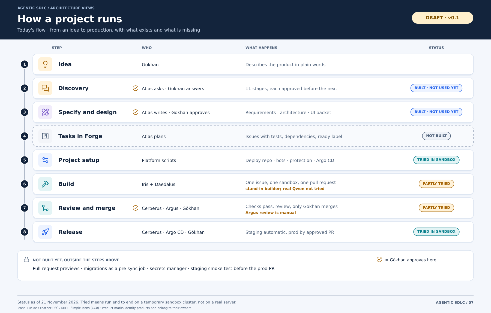
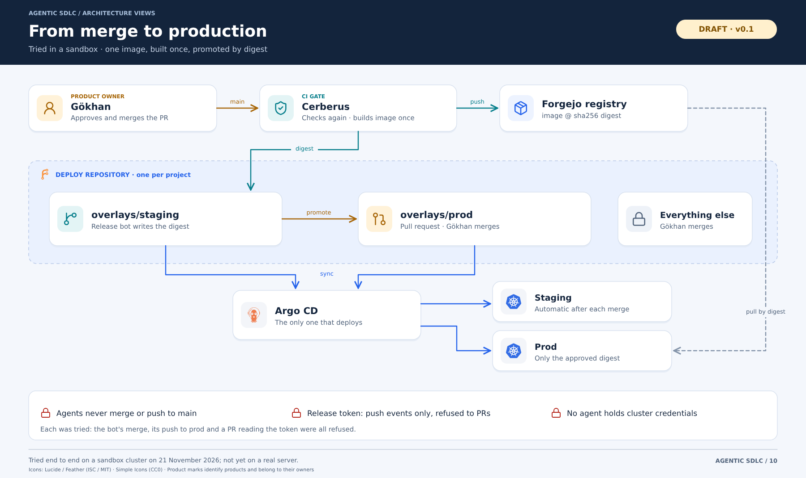

# Process and architecture diagrams

These views make the proposed method discussable. All are **draft v0.1**. They do not claim an implemented dispatcher, a fixed model/agent count, or a finalized application topology.

## Target architecture views

These views accompany the [target architecture](../architecture/README.md). Actors appear under the names in [the cast](../architecture/cast.md). Each card carries one icon, a short title and at most one short line; the explanation lives in that document.


[SVG](04-system-map.svg) · [PNG](04-system-map.png)


[SVG](05-who-does-what.svg) · [PNG](05-who-does-what.png)


[SVG](06-where-it-runs.svg) · [PNG](06-where-it-runs.png)



[SVG](07-project-start.svg) · [PNG](07-project-start.png)


[SVG](08-cast.svg) · [PNG](08-cast.png)


[SVG](09-two-loops.svg) · [PNG](09-two-loops.png)



[SVG](10-release-path.svg) · [PNG](10-release-path.png)

## Development process

The view covers brief, requirements, architecture, repository/tasks, implementation/verification, and delivery. Dashed arrows represent findings returning to planning. Human direction applies throughout.


[SVG](01-development-process.svg) · [PNG](01-development-process.png)

## Backend agent responsibilities

The human supplies intent. The Architect/Planner decomposes work; the Coordinator dispatches ready packets; one Implementer owns a coding task; the Independent Reviewer checks the candidate; CI supplies execution evidence. Shared artifacts carry state across scoped sessions. Role boxes are not permanent process/model counts. See the normative [delivery workflow](../../standards/backend/delivery-workflow.md).


[SVG](02-agent-structure.svg) · [PNG](02-agent-structure.png)

## Illustrative project architecture

The view separates UI, API, business behavior, and data/integration responsibilities. Arrows show runtime interactions. Separate logical boxes do not require separate microservices/repositories. Actual technology, identity, and deployment profiles are project decisions.


[SVG](03-project-architecture.svg) · [PNG](03-project-architecture.png)

## Edit and regenerate

SVG files are editable vectors. The repeatable source is [render_diagrams.py](../../scripts/render_diagrams.py). Carry direct SVG/PNG edits back into the generator if they must survive regeneration.

Requires Python 3.10+, Pillow, DejaVu Sans fonts, and either Inkscape or Node with a Playwright Chromium. From the repository root:

```sh
python scripts/render_diagrams.py          # all views
python scripts/render_diagrams.py 04 06    # selected views
```

Rendering uses local assets and no network. The generator checks card text widths. PNGs are 1800 pixels wide; use SVG for scaling. Views 01–03 were rendered with Inkscape. Views 04–09 were rendered with the Chromium fallback because Inkscape was unavailable in the authoring environment; rerendering 01–03 with a different rasterizer can change their pixels.

Generic icons come from [Lucide](assets/lucide/README.md). Product marks in views 04–09 come from [Simple Icons](assets/simple-icons/README.md) and are used only to identify the products they name. Provenance and license notices are recorded in both directories and in the PNG metadata.
